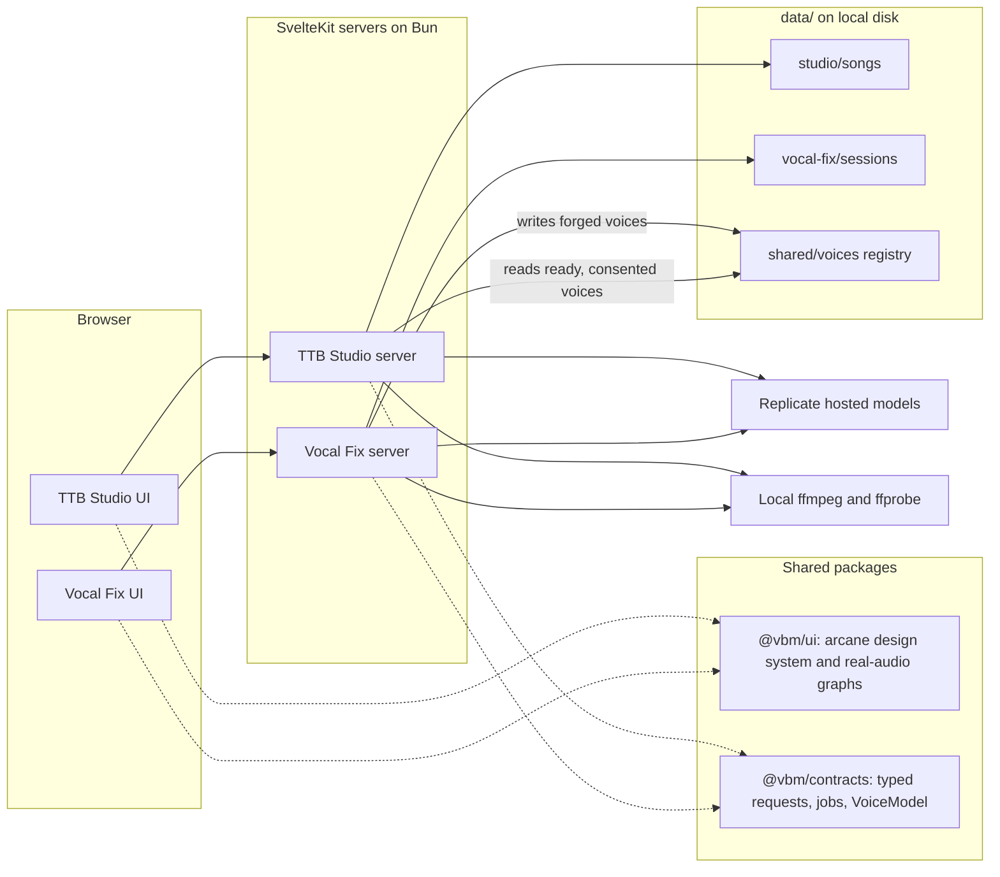
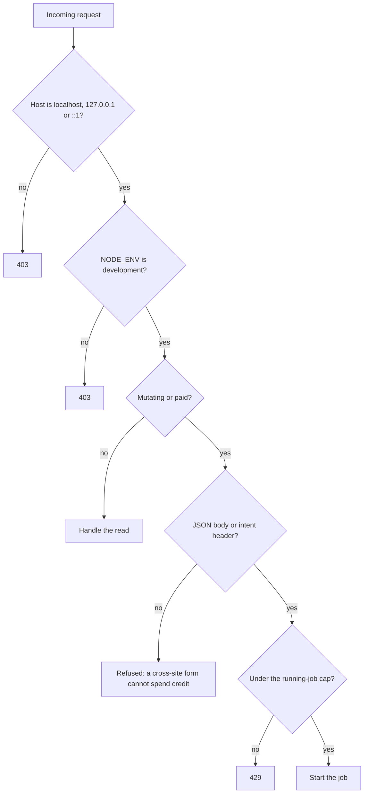
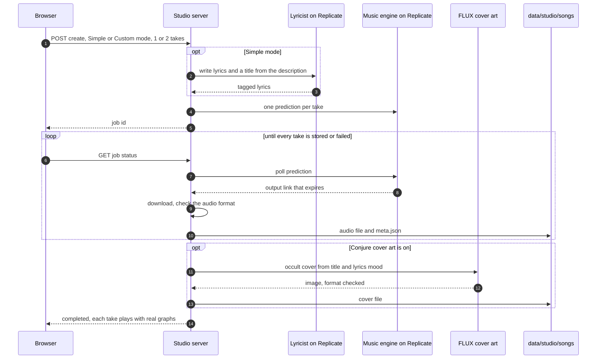
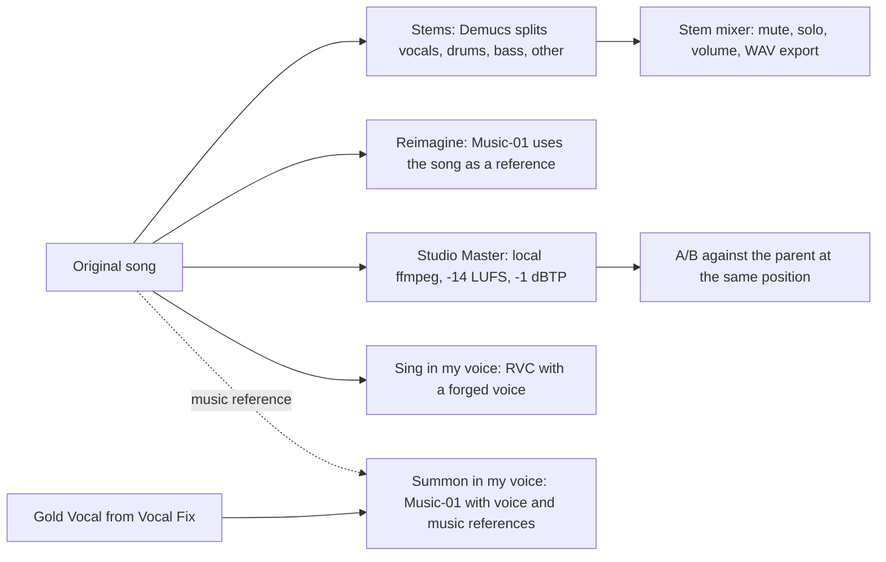
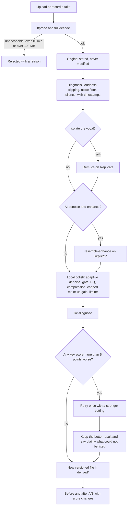
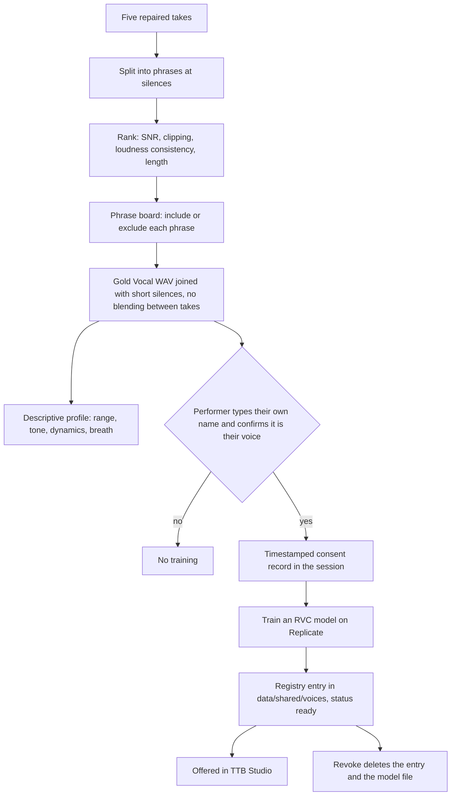
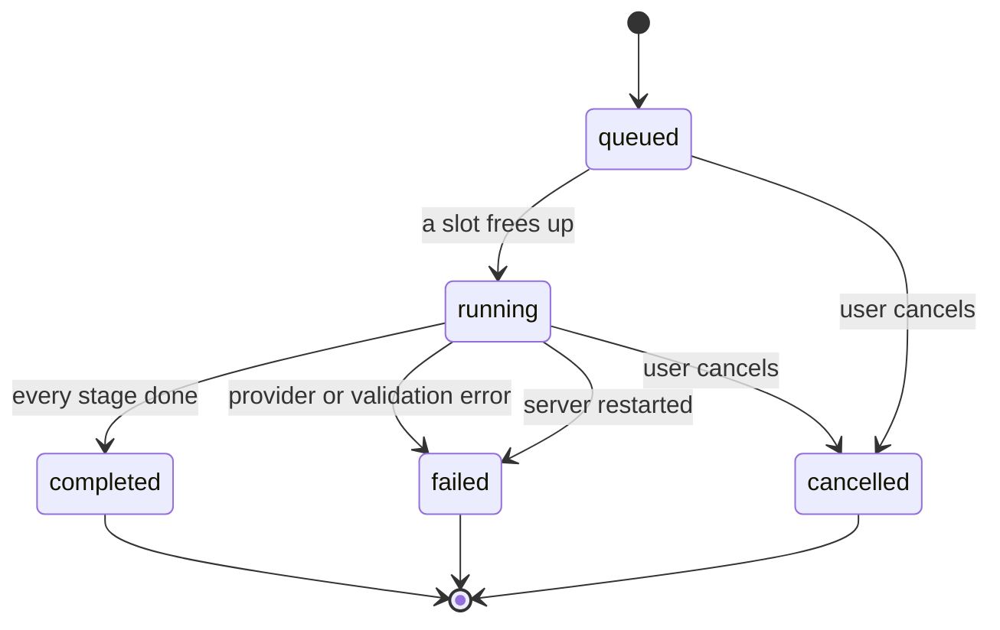
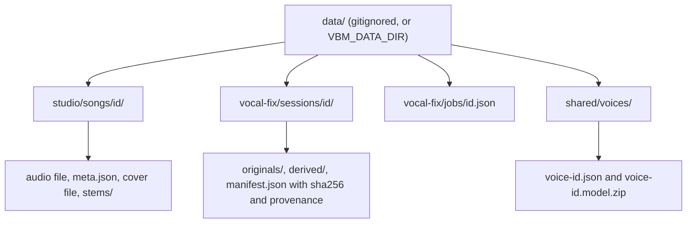
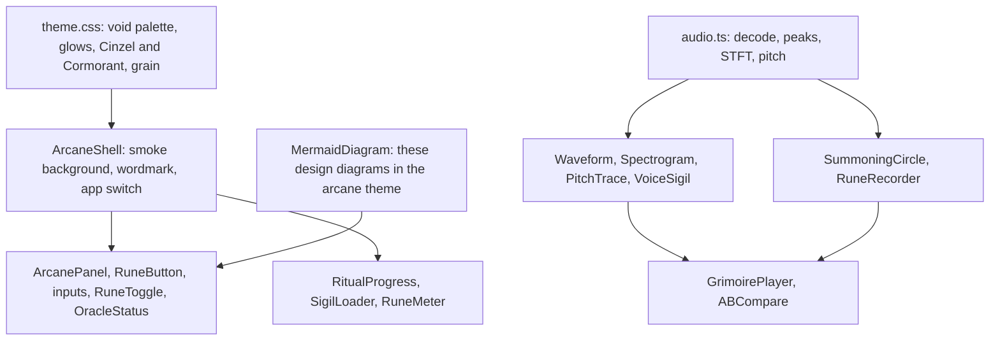

# Design: how Vocal Black Magic fits together

For anyone changing the two apps: the shape of the system as built on the `feature/vbm-upgrade` branch, drawn as Mermaid diagrams. GitHub renders them here, and both apps show the same diagrams in the arcane theme on their `/arcana` page, which reads this file at build time. Edit a diagram here and both places update.

Everything below runs for **local development only**: there is no authentication, and paid routes return 403 outside `NODE_ENV=development`. See [ARCHITECTURE.md](ARCHITECTURE.md) for the target SaaS shape and [RIGHTS_AND_SAFETY.md](RIGHTS_AND_SAFETY.md) for the consent rules.

## The two apps and what they share

## Request guard on every paid or mutating route

## TTB Studio: summoning a song

## TTB Studio: what can be derived from a song

Every derived song is a new library entry with `parent_id`, so the original is never overwritten. Derived songs inherit the parent's cover unless it is re-conjured.

## Vocal Fix: repairing a take

## Vocal Fix: from five takes to a forged voice

## Job lifecycle

Both apps run long work as jobs that the browser polls. Vocal Fix runs at most two repair or forge jobs at once (one forge), saves job state under `data/vocal-fix/jobs/`, and marks jobs cut off by a restart as failed. TTB Studio refuses new paid work while three jobs are running.

## Where data lives

## The design system

Graphs only ever draw decoded audio. With no audio they show an empty "awaiting sound" state, never a placeholder waveform.
