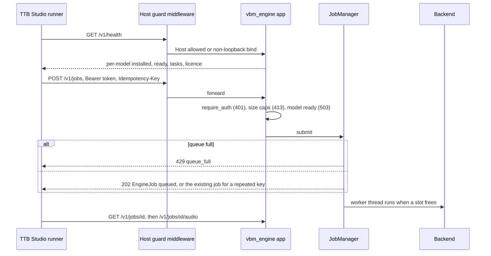

# Audio Engine

> Category: Architecture | Version: 1.0 | Date: November 2026 | Status: Active

For engineers running or extending `services/audio-engine`: the self-hosted music engine that TTB Studio can call as a runner, its protocol v1, auth, job queue, backends and packaging. Pinned to commit b58d4574. CI tests the engine only against a fake sine-wave backend, so real model output is unverified.

**Related:**
- [`song-studio.md`](song-studio.md)
- [`test-strategy.md`](test-strategy.md)
- [`../security/trust-boundaries.md`](../security/trust-boundaries.md)
- [`../../../../docs/ENGINE_PROTOCOL.md`](../../../../docs/ENGINE_PROTOCOL.md)
- [`../../../../docs/decisions/0003-runtime-boundary.md`](../../../../docs/decisions/0003-runtime-boundary.md)

---

## Why it exists

ADR 0003 allows private Python GPU workers. The engine lets the studio run open models on any machine with a GPU, without a hosted provider. It is a separate FastAPI process, not a product service. Shared TypeScript types and validation live in `packages/contracts/src/engine.ts` (protocol version at line 6, models at line 9, tasks at line 13, job-id pattern at line 119). A shared fixture checks that both sides validate the same way (`packages/contracts/fixtures/engine-requests.json`, `services/audio-engine/tests/test_validation_parity.py:16`).

## Request path

## Auth and binding

The token comes from `VBM_ENGINE_TOKEN`. `create_app` raises without it, and `python -m vbm_engine` exits with code 2 (`services/audio-engine/vbm_engine/app.py:104-105`, `services/audio-engine/vbm_engine/__main__.py:31-36`). `require_auth` compares the bearer value with `hmac.compare_digest` and answers 401 on mismatch (`app.py:137-144`). `/v1/health` needs no token (`app.py:161-174`). When the bind host is loopback, middleware refuses a foreign Host header with 403 (`app.py:108-114`, `__main__.py:13-19`, `__main__.py:37`). The Dockerfile binds `0.0.0.0` (`services/audio-engine/Dockerfile:55`), which turns that check off and leaves only the token. The studio client sends `authorization: Bearer` and accepts plain `http:` URLs (`apps/ttb-studio/src/lib/server/studio/runners/engine.ts:36-50`), so a remote engine needs HTTPS to keep the token private.

## Limits and jobs

`source_audio` is capped at 50 MiB decoded, and the whole body is rejected before parsing above the base64 size plus 1 MiB (`app.py:29-31`, `app.py:186-222`). Settings come from the environment (`app.py:47-55`):

- `VBM_ENGINE_DATA`: job state.
- `VBM_ENGINE_CACHE`: weights, kept outside git.
- `VBM_ENGINE_CONCURRENCY`: GPU slots, default 1.
- `VBM_ENGINE_MAX_QUEUE`: queue length, default 16.

`JobManager` persists `jobs/<id>.json` and a work directory, maps idempotency keys to existing jobs and runs worker threads (`services/audio-engine/vbm_engine/jobs.py:1-6`, `jobs.py:111-141`, `jobs.py:195-213`). Inputs are not persisted. On restart any queued or running job becomes failed with "interrupted by restart" (`jobs.py:82-99`). The idempotency map is rebuilt from disk. The studio sends a fresh random idempotency key per submit (`apps/ttb-studio/src/lib/server/studio/runners/routed.ts:75-84`), and no automatic retry with the same key was found, so in practice the key does not deduplicate anything today; a repeated user click creates a second paid job.

## Backends

| Backend | Licence label | Tasks | Source |
|---|---|---|---|
| ACE-Step 1.5 | MIT | text2music, extend, repaint, cover | `vbm_engine/backends/ace_step.py:44-46` |
| HeartMuLa | Apache-2.0 | text2music | `backends/heartmula.py:33-35` |
| DiffRhythm 2 | Apache-2.0 | text2music | `backends/diffrhythm.py:34-36` |
| YuE2 | CC-BY-NC-4.0, commercial false | text2music | `backends/yue2.py:1`, `yue2.py:31-33` |

The licence labels are what the code reports, not a verified review. Readiness reports "deps not installed" or "weights not downloaded". It also reports a GPU memory shortfall, or refuses CPU unless `VBM_ENGINE_ALLOW_CPU` is set (`services/audio-engine/vbm_engine/backends/common.py:11-41`). The device order is cuda, then mps, then cpu (`services/audio-engine/vbm_engine/device.py:1-22`). Health reports `ready` only from this check (`app.py:146-159`); the check confirms that weights exist, not that a generation succeeds.

## Packaging

- `Dockerfile`: CUDA 12.8 runtime, non-root `engine` user, port 8090, healthcheck with `Host: localhost` (`Dockerfile:8-55`).
- `modal_app.py`: a serverless option with at most one container, marked "NOT DEPLOYED" because running it spends money (`services/audio-engine/modal_app.py:1-33`).
- Per-model `requirements-*.txt` files and `install-ace-step.sh`.

CI job `audio-engine` uses Python 3.12. It installs base and dev requirements only (no torch) and runs pytest, ruff and mypy (`.github/workflows/ci.yml:40-56`).
