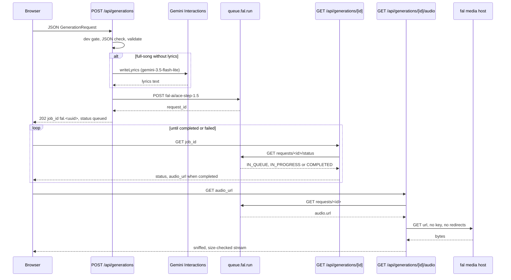

# Music Generation Pipeline

> Category: Architecture | Version: 1.0 | Date: November 2026 | Status: Active

For engineers working on TTB Studio: how a song request travels from the browser through validation, optional lyric writing, fal ACE-Step 1.5 or Google Lyria 3.5, and back as verified audio. Pinned to commit 29c84e47. This path is development-only and stores nothing.

**Related:**
- [`test-strategy.md`](test-strategy.md)
- [`../security/trust-boundaries.md`](../security/trust-boundaries.md)
- [`../auth/session-and-tenancy-model.md`](../auth/session-and-tenancy-model.md)
- [`../../../../docs/decisions/0002-modular-monolith.md`](../../../../docs/decisions/0002-modular-monolith.md)
- [`../../../../docs/decisions/0003-runtime-boundary.md`](../../../../docs/decisions/0003-runtime-boundary.md)

---

## Why it is shaped this way

Generation runs inside the TTB Studio SvelteKit server and calls hosted providers directly; the legacy Python `/api/generations` still answers 503 unconditionally (`apps/ttb_studio/app.py:64-70`) and is not called. The two engines have opposite shapes: fal is an asynchronous queue, so the browser polls; Lyria answers synchronously with inline audio. A job id prefix tells later requests which provider owns the job (`apps/ttb-studio/src/lib/server/music/jobs.ts:1-14`).

## The request contract

`GenerationRequest` in `@vbm/contracts` has ten fields, including `engine`, `mode`, `lyrics: string | null` and `duration_seconds` (`packages/contracts/src/index.ts:13-24`). Engines are `ace-step`, `lyria-3.5`, `heartmula` and `external-v2` (`packages/contracts/src/index.ts:10`).

Validation happens in two layers inside `POST /api/generations`. The route first checks primitive types, requiring `lyrics` to be either `null` or a string and returning 422 otherwise (`apps/ttb-studio/src/routes/api/generations/+server.ts:33-44`). It then calls `validateGenerationRequest` (`+server.ts:45-46`), which enforces a 5 to 3000 character trimmed prompt, lyrics at most 15,000 characters, a known engine, sound character and mode, an integer duration from 10 to 240 seconds, and integer intensities from 0 to 100 (`packages/contracts/src/index.ts:71-91`, bounds at `index.ts:25-26`).

Before that, the route enforces the development gate (`+server.ts:23-24`) and a JSON content type (`+server.ts:25-26`), and rejects unparseable JSON with 400 (`+server.ts:28-32`).

## The fal ACE-Step path

**Preconditions.** Without `FAL_KEY` the route answers 503 (`+server.ts:50-55`). `aceStepRequestError` rejects a style description over 512 characters or lyrics over 4096 before any money is spent (`apps/ttb-studio/src/lib/server/music/fal.ts:8-9`, `fal.ts:21-30`, route use at `+server.ts:56-57`). The style description is the trimmed prompt plus the sound character name (`apps/ttb-studio/src/lib/server/music/prompt.ts:3-10`).

**Lyrics.** Lyrics count as sung only in `full-song` mode with non-empty text (`prompt.ts:12-15`). A full song without lyrics needs `GEMINI_API_KEY`, else 503 (`+server.ts:60-69`). `writeLyrics` posts to the Interactions endpoint with model `gemini-3.5-flash-lite`, `store: false`, minimal thinking and 1500 output tokens, and a 60 second timeout (`apps/ttb-studio/src/lib/server/music/lyricist.ts:6-9`, `lyricist.ts:97-112`). The prompt picks a section shape from the duration (`lyricist.ts:16-20`). `cleanLyrics` strips code fences, trims to 4096 characters at a line break, and rejects text with fewer than three real words (`lyricist.ts:64-95`). An `incomplete` status becomes a 502 (`lyricist.ts:47-52`).

**Submit.** `buildFalSubmission` sends `prompt`, `lyrics` (`[Instrumental]` in instrumental mode), `duration`, `thinking: true` and `enable_safety_checker: true` to app `fal-ai/ace-step-1.5` (`fal.ts:32-53`), and refuses a full song without lyrics (`fal.ts:36-41`). `submitFal` posts to the queue with a 15 second timeout and requires a UUID `request_id` (`fal.ts:79-104`). If submission fails after paid lyrics were written, the error response carries those lyrics back so a retry can reuse them (`+server.ts:76-84`). Success is a 202 with `job_id` `fal.<request_id>` and status `queued` (`+server.ts:85-91`, prefix at `jobs.ts:3-5`).

**Poll.** `GET /api/generations/[id]` parses the prefix, lowercases the request id and requires a UUID, else 404 (`apps/ttb-studio/src/routes/api/generations/[id]/+server.ts:12-19`, `jobs.ts:10-11`). `falStatus` maps `IN_QUEUE` to `queued`, `IN_PROGRESS` to `running`, `COMPLETED` to `completed`, or to `failed` when fal reports an error; any other status is a 502 (`fal.ts:106-130`). On completion the response adds `audio_url` pointing at the audio route (`[id]/+server.ts:35-36`).

**Audio.** `GET /api/generations/[id]/audio` accepts only fal job ids (`[id]/audio/+server.ts:12-14`). `falAudioUrl` reads the result and rejects any URL outside the fal media allow-list (`fal.ts:132-159`). The download refuses redirects and allows 120 seconds (`[id]/audio/+server.ts:22-24`).

## The Lyria 3.5 path

With `GEMINI_API_KEY` set (else 503 at `+server.ts:94-99`), `generateLyria` posts model `lyria-3.5` with API revision `2026-05-20` and a 300 second timeout (`apps/ttb-studio/src/lib/server/music/lyria.ts:7-8`, `lyria.ts:75-88`). The prompt adds an instrumental instruction, the user's lyrics, or a request for clear original lyrics, plus the target length (`lyria.ts:15-23`). `parseLyriaInteraction` collects the audio and text blocks from `model_output` steps and fails with 502 if there is no audio or the format is not MP3 or WAV (`lyria.ts:35-73`). The route returns 200 with a `lyria.<random uuid>` job id, status `completed`, inline base64 audio and lyrics (`+server.ts:100-108`). Nothing is stored, so polling a Lyria id returns 404 (`[id]/+server.ts:13-17`).

Engines `heartmula` and `external-v2` pass validation but return 501 (`+server.ts:110`).

## Audio verification

`verifiedAudioResponse` refuses a non-OK upstream, refuses a declared `content-length` below 1 KiB or above 160 MiB, and reads just enough leading bytes to identify the format (`apps/ttb-studio/src/lib/server/music/audio.ts:4-5`, `audio.ts:98-113`). Sniffing recognises RIFF/WAVE, ID3 or MPEG frame sync, FLAC and Ogg, and looks past an ID3 tag of up to 4 MiB (`audio.ts:11-48`). Non-audio is a 502 (`audio.ts:114-117`). The body then streams through a counter that errors on truncation below 1 KiB or growth past 160 MiB (`audio.ts:118-141`), served with the sniffed type, `private, no-store` and `nosniff` (`audio.ts:142-148`). Lyria inline audio gets the equivalent check on base64 length and header bytes (`audio.ts:52-68`).

Sniffing proves the header looks like audio. It does not decode the whole file.

## Error mapping

Providers throw `ProviderError(status, publicMessage, logDetail)` (`apps/ttb-studio/src/lib/server/music/errors.ts:1-10`). `errorResponse` logs the detail server-side and returns only the public message; any other error becomes 504 on timeout or 502 otherwise (`errors.ts:11-29`).

| Upstream | fal (`fal.ts:63-77`) | Lyria (`lyria.ts:89-113`) | Lyricist (`lyricist.ts:113-141`) |
|---|---|---|---|
| 400 | 502 | 422 | 422 |
| 401 or 403 | 502, check key | 502, check key or paid access | 502 |
| 402 | 402, no credit | not mapped, 502 | not mapped, 502 |
| 404 after submit | 404 | not mapped | not mapped |
| 422 on submit | 422 | not mapped | not mapped |
| 429 | 429 | 402 if free tier or zero limit, else 429 | 429 |
| other | 502 | 502 | 502 |
