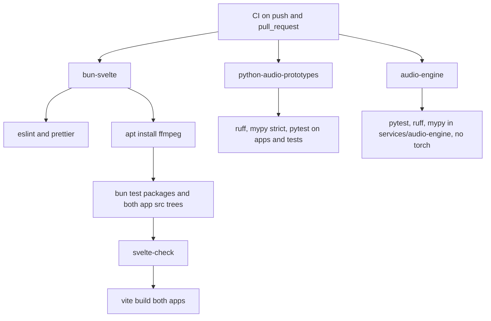

# Test Strategy

> Category: Architecture | Version: 2.0 | Date: November 2026 | Status: Active

For engineers changing any app or the engine: how the automated checks are split across Bun/TypeScript, the legacy Python prototypes and the self-hosted engine, what each proves, and what nothing tests. Pinned to commit b58d4574 (version 1.0 was pinned to 29c84e47).

**Related:**
- [`song-studio.md`](song-studio.md)
- [`vocal-fix-pipeline.md`](vocal-fix-pipeline.md)
- [`audio-engine.md`](audio-engine.md)
- [`../security/trust-boundaries.md`](../security/trust-boundaries.md)
- [`../../../../docs/decisions/0003-runtime-boundary.md`](../../../../docs/decisions/0003-runtime-boundary.md)

---

## Three independent CI jobs

CI runs on every push and pull request with read-only permissions (`.github/workflows/ci.yml:1-6`). Its three jobs never start each other's runtimes. No automated check runs TTB Studio against a live engine or a real provider.

## bun-svelte

The job pins Node 22.17.0 and Bun 1.4.0 and runs plain `bun install`, not `--frozen-lockfile` (`.github/workflows/ci.yml:12-19`). It then runs lint, format check, an ffmpeg install, tests, type check and build (`ci.yml:20-26`). The test command is `bun test packages apps/ttb-studio/src apps/vocal-fix/src` (`package.json:19`), so Vocal Fix is now covered.

| Area | Files | Highlights |
|---|---|---|
| Contracts | `packages/contracts/src/index.test.ts`, `engine.test.ts` | legacy validator; engine request fixture |
| UI helpers | `packages/ui/src/audio.test.ts`, `region.test.ts`, `mermaid-doc.test.ts` | audio maths; `docs/DESIGN.md` must contain at least 8 valid diagrams (`mermaid-doc.test.ts:40-48`) |
| Legacy music | `apps/ttb-studio/src/lib/server/music/music.test.ts`, `lyrics.test.ts` | as in version 1.0 |
| Studio | `apps/ttb-studio/src/lib/server/studio/{studio,edit,lyrics,review,seal,seance}.test.ts`, `runners/{router,engine,direct,capabilities}.test.ts` | library, jobs, router fallback, engine client, direct adapters, sealing |
| Vocal Fix | `apps/vocal-fix/src/lib/server/server.test.ts` | storage, ffprobe validation on generated audio, diagnosis, polish chain, Gold Vocal, consent and registry, host guard, job limits and restart, never-worse guard (`server.test.ts:47-587`) |
| Client | `apps/ttb-studio/src/lib/client/seance-time.test.ts` | séance timing |

These tests use injected `fetch` and mocks. The Vocal Fix block named "replicate regressions (live e2e)" also uses a stubbed fetch (`server.test.ts:318-330`). Not every test body was read, so "no network in any test" is unverified.

## python-audio-prototypes

Python 3.11 runs ruff, `mypy` strict and `pytest -q` over `apps` and `tests` (`ci.yml:27-39`). `tests/test_apps.py` covers only the legacy FastAPI prototypes, with synthetic `RIFF` bytes, as in version 1.0.

## audio-engine

Python 3.12 in `services/audio-engine` installs `requirements-base.txt` and `requirements-dev.txt` only (no torch or model code) and runs pytest, ruff and mypy (`ci.yml:40-56`). The tests use a fake sine-wave backend (`services/audio-engine/tests/fake_backend.py`):

- `test_protocol.py`: 17 tests.
- `test_backends.py`: 5 tests.
- `test_validation_parity.py`: fixture parity with the TypeScript validator.

Locally, `bun run test:engine`, `lint:engine` and `check:engine` expect a venv at `services/audio-engine/.venv` (`package.json:31-33`).

## What is untested

- **SvelteKit route handlers.** No test imports a `+server.ts` file (repository grep). The guards are tested only as library functions.
- **Real providers.** Replicate, fal, Google, MiniMax, ElevenLabs, Anthropic and OpenAI are never contacted.
- **Real models in the engine.** No backend runs real weights in CI. The Dockerfile and `modal_app.py` are not built or deployed.
- **Browser UI.** There are no Playwright or component tests. `axe-core` is a dev dependency, but no test using it was found.
- **Cross-process integration.** The studio is not tested against a running engine.
- **Deployment artifacts.** `compose.yaml`, the Dockerfiles and the systemd units are not exercised.
