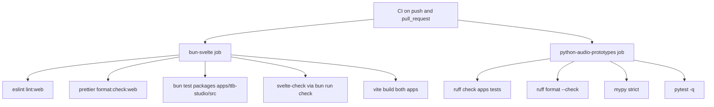

# Test Strategy

> Category: Architecture | Version: 1.0 | Date: November 2026 | Status: Active

For engineers changing either app: how the automated checks are split between the Bun/TypeScript side and the Python side, what each check proves, and what nothing tests today. Pinned to commit 29c84e47.

**Related:**
- [`music-generation-pipeline.md`](music-generation-pipeline.md)
- [`vocal-reference-storage.md`](vocal-reference-storage.md)
- [`../security/trust-boundaries.md`](../security/trust-boundaries.md)
- [`../../../../docs/decisions/0003-runtime-boundary.md`](../../../../docs/decisions/0003-runtime-boundary.md)

---

## Why the suite is split in two

The repository holds two runtimes: SvelteKit apps run by Bun, and FastAPI prototypes run by Python. CI mirrors that with two independent jobs, `bun-svelte` (`.github/workflows/ci.yml:8`) and `python-audio-prototypes` (`.github/workflows/ci.yml:25`). Neither job starts the other runtime, so no automated check exercises a SvelteKit route talking to a live Python process.

CI triggers on every push and pull request with read-only repository permissions (`.github/workflows/ci.yml:2-6`).

## The Bun and Svelte job

The job pins Node 22.17.0 and Bun 1.4.0 (`.github/workflows/ci.yml:12-17`), then runs, in order, lint, format check, unit tests, type check and build (`.github/workflows/ci.yml:19-24`).

**ESLint.** `lint:web` lints both app folders and `packages` with zero warnings allowed (`package.json:21`). The config applies the recommended JavaScript, typescript-eslint and Svelte rule sets (`eslint.config.mjs:18-20`) and parses Svelte script blocks with the TypeScript parser (`eslint.config.mjs:24-27`).

**Prettier.** `format:check:web` checks formatting of app and package sources (`package.json:24`). It proves style only.

**bun test.** The command is `bun test packages apps/ttb-studio/src` (`.github/workflows/ci.yml:22`, `package.json:19`). It therefore discovers tests in `packages/` and in TTB Studio source only; `apps/vocal-fix` is outside the path. Three test files exist on the ref:

| File | What it covers |
|---|---|
| `packages/contracts/src/index.test.ts` | `validateGenerationRequest`: valid request, out-of-range intensity, short prompts, Lyria engine accepted, song length outside 10 to 240 seconds (`packages/contracts/src/index.test.ts:15-23`) |
| `apps/ttb-studio/src/lib/server/music/music.test.ts` | Audio sniffing and verified streaming (`music.test.ts:50-118`), fal adapter submission, status mapping, credit and key errors, media host allow-list, job id round trip (`music.test.ts:128-204`), Lyria prompt, parsing and billing error (`music.test.ts:211-261`), capabilities (`music.test.ts:286`) and the JSON content-type gate (`music.test.ts:308-320`) |
| `apps/ttb-studio/src/lib/server/music/lyrics.test.ts` | Lyricist prompt shape, request headers, filler rejection, prompt-injection framing, truncation, error mapping (`lyrics.test.ts:47-116`), ACE-Step limits (`lyrics.test.ts:131-132`) and Lyria lyric prompt (`lyrics.test.ts:142-143`) |

These tests target the `lib/server/music` modules with injected `fetch` dependencies (the `FalDeps`, `LyriaDeps` and `LyricistDeps` interfaces at `apps/ttb-studio/src/lib/server/music/fal.ts:12-15`, `lyria.ts:10-13`, `lyricist.ts:11-14`). They never contact fal or Google (inferred from the dependency injection design; individual test bodies beyond the listed lines were not re-read line by line, so treat "no network" as unverified for every case).

**svelte-check.** `bun run check` runs `svelte-kit sync` and `svelte-check` in each app (`package.json:18`, `apps/ttb-studio/package.json:10`, `apps/vocal-fix/package.json:10`). This is the only automated check that touches `apps/vocal-fix` TypeScript and Svelte files beyond lint.

**Build.** `bun run build` builds Vocal Fix then TTB Studio (`package.json:15`). A passing build proves compilation, not runtime behavior.

## The Python job

The job uses Python 3.11 and installs `requirements-dev.txt` (`.github/workflows/ci.yml:31-33`).

**Ruff.** Lint and format checks run over `apps` and `tests` (`.github/workflows/ci.yml:34-35`). The selected lint rules are the narrow `E4`, `E7`, `E9`, `F` and `I` families (`pyproject.toml:6`).

**mypy.** `mypy` runs in strict mode over `apps/__init__.py`, `apps/vocal_fix`, `apps/ttb_studio` and `tests` (`pyproject.toml:8-11`).

**pytest.** `pytest.ini` sets `pythonpath = .` and `testpaths = tests` (`pytest.ini:1-3`). The single file `tests/test_apps.py` describes itself as HTTP contract tests with no inference and no GPU (`tests/test_apps.py:1`). It uses FastAPI's in-process `TestClient` (`tests/test_apps.py:11-12`) and covers:

- Health names and homepage for both Python apps (`tests/test_apps.py:15-19`).
- Vocal Fix refuses an upload without rights acknowledgement with 403 (`tests/test_apps.py:26-31`) and four files with 422 (`tests/test_apps.py:34-41`).
- Vocal Fix upload, fetch, 501 process, delete, then 404 (`tests/test_apps.py:44-59`).
- Legacy TTB Python capabilities and its 503 generation refusal (`tests/test_apps.py:62-76`) and 422 on invalid values (`tests/test_apps.py:79-81`).

Upload fixtures are synthetic: `b"RIFF"` followed by 40 filler bytes (`tests/test_apps.py:22-23`). Each upload test isolates storage by pointing `VFM_DATA_DIR` at `tmp_path` (`tests/test_apps.py:27`).

## What is untested

The following have no automated test on this ref. Each item is an absence observed from the file list and test contents above.

- **SvelteKit route handlers.** No test imports any `+server.ts` file. The production 403 guards (`apps/ttb-studio/src/lib/server/music/gate.ts:1-12`, `apps/vocal-fix/src/routes/api/references/+server.ts:7-13`) and the request flow in `apps/ttb-studio/src/routes/api/generations/+server.ts:22-114` are exercised only by type checking. `generationAllowed` itself is not tested; the capabilities test passes the flag in directly (`music.test.ts:286-305`).
- **Vocal Fix SvelteKit proxy.** Its validation and pass-through (`apps/vocal-fix/src/routes/api/references/+server.ts:20-50`) sit outside the `bun test` path.
- **Real provider calls.** No test hits `queue.fal.run` or `generativelanguage.googleapis.com`.
- **Real media.** Python fixtures are not decodable audio, and the Python intake never decodes audio (`apps/vocal_fix/app.py:118`).
- **Browser UI.** No Playwright or component tests exist for either `+page.svelte`.
- **Cross-process integration.** No test runs a SvelteKit app against a running Python API.
- **Deployment artifacts.** `compose.yaml`, `Dockerfile` and the systemd units are not exercised by CI (`.github/workflows/ci.yml:19-37` contains no step that uses them).

## Running locally

Run `bun test packages apps/ttb-studio/src` and `bun run check` for the Bun side (`package.json:18-19`). Run `python -m pytest -q` from the repository root in a Python 3.11 environment for the Python side (`package.json:30`, `pyproject.toml:9`).
