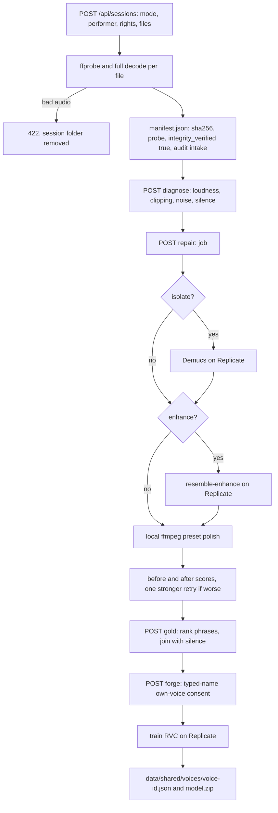

# Vocal Fix Pipeline

> Category: Architecture | Version: 1.0 | Date: November 2026 | Status: Active

For engineers working on Vocal Fix: how the SvelteKit server takes in recordings, verifies and diagnoses them, repairs takes, assembles a Gold Vocal and trains a consented voice. Pinned to commit b58d4574. Everything here runs in development only, with no authentication.

**Related:**
- [`vocal-reference-storage.md`](vocal-reference-storage.md) (legacy Python intake)
- [`song-studio.md`](song-studio.md) (reads the shared voice registry)
- [`test-strategy.md`](test-strategy.md)
- [`../security/trust-boundaries.md`](../security/trust-boundaries.md)
- [`../../../../docs/decisions/0004-vocal-fix-pipeline-in-sveltekit.md`](../../../../docs/decisions/0004-vocal-fix-pipeline-in-sveltekit.md)

---

## Why it lives in SvelteKit

ADR 0004 moved the pipeline out of the Python prototype, which still answers 501 for processing. The Bun server spawns `ffmpeg`/`ffprobe` for local DSP and calls Replicate for GPU stages. The UI calls `/api/sessions/**` (`apps/vocal-fix/src/routes/+page.svelte:77-79`); the older `/api/references` proxy to Python still exists but the UI does not use it.

## Gates on every request

`hooks.server.ts` refuses any `/api/` request whose Host header is not `localhost`, `127.0.0.1` or `[::1]` with 403 (`apps/vocal-fix/src/hooks.server.ts:5-10`, `apps/vocal-fix/src/lib/server/gate.ts:84-96`). State-changing routes call `guardMutation`. It applies the host check, then the development-only gate (403 unless `NODE_ENV === 'development'`), then requires JSON or a non-empty `x-vbm-intent` header (415) (`gate.ts:1-12`, `gate.ts:35-46`). Read routes call only `disabledResponse` (for example `apps/vocal-fix/src/routes/api/sessions/[id]/+server.ts:6-7`). `GET /api/capabilities` is ungated and reports `processing_allowed` and `hosted_ready` (`apps/vocal-fix/src/routes/api/capabilities/+server.ts:9-27`).

None of these checks identify a user. Anyone who can reach the dev server on localhost can read, process or delete any session whose id they know.

## Flow

## Intake

`POST /api/sessions` caps the body at five times 100 MB plus 1 MiB while streaming (413) and parses multipart (`apps/vocal-fix/src/routes/api/sessions/+server.ts:7-19`). `VocalFixService.intake` requires mode `fix` (exactly one file) or `forge` (exactly five), `acknowledged_rights === true` (403), and a 2 to 120 character performer name (`apps/vocal-fix/src/lib/server/service.ts:105-126`). Each file needs an allowed extension (415), at least 1 KiB and at most 100 MB (`service.ts:127-134`, limit at `apps/vocal-fix/src/lib/server/media.ts:11`). The file is written with `flag: 'wx'`, then `probeAndVerify` probes it and decodes it in full. On failure the request gets 422 and the whole session folder is removed (`service.ts:143-176`). Duration is capped at 600 s with a codec allow-list (`media.ts:12-26`). Recordings store `sha256` and `integrity_verified: true` (`service.ts:158-167`). The manifest records a fixed rights statement and timestamp, plus an `intake` audit event (`service.ts:136-171`).

## Storage

`SessionStore` roots sessions at `<data>/vocal-fix/sessions/<uuid>/` with `originals/` and `derived/` (`apps/vocal-fix/src/lib/server/storage.ts:71-103`). The data directory is `VBM_DATA_DIR` or `<repo root>/data`, where the repo root is the nearest folder holding `bun.lock` (`apps/vocal-fix/src/lib/server/paths.ts:4-18`). Session ids must match a UUID pattern, and file paths are resolved and checked against the root to block traversal (`storage.ts:80-95`). The manifest is written to a temp file and renamed (`storage.ts:115-120`). Originals are never rewritten; every result is a new derived version with provenance (`storage.ts:36-45`). File modes are not set explicitly, so they follow the process umask (unverified at runtime).

## Repair jobs

`startRepair` builds stages for optional isolate and enhance plus the preset polish (`service.ts:281-300`). Hosted stages need `REPLICATE_API_TOKEN` and otherwise answer 503. Models and estimated costs are pinned in `apps/vocal-fix/src/lib/server/replicate.ts:6-20`: `ryan5453/demucs` about $0.03, `resemble-ai/resemble-enhance` about $0.02 and `replicate/train-rvc-model` about $0.26. The polish compares before and after scores. If they regress, it tries one stronger variant and keeps it only if that variant regresses less (`service.ts:430-455`). Presets live in `apps/vocal-fix/src/lib/server/chain.ts:25`.

Jobs persist as `<data>/vocal-fix/jobs/<id>.json`. At most two run at once and at most one forge; the rest wait as `queued` (`apps/vocal-fix/src/lib/server/jobs.ts:44-54`, `jobs.ts:133-136`). At startup `recover()` marks any job left queued or running as failed with "interrupted by restart" (`jobs.ts:23`, `jobs.ts:71-88`, called at `service.ts:88`).

## Gold Vocal and profile

`gold()` splits takes into phrases at silences, measures and ranks them, selects phrases and lays them out as segments joined by ffmpeg (`apps/vocal-fix/src/lib/server/gold.ts:33-156`, `service.ts:530-626`). It stores `gold` and a descriptive `profile` of observable traits such as pitch range on the manifest (`apps/vocal-fix/src/lib/server/profile.ts:92-167`). It does not average waveforms.

## Voice forge and consent

`startForge` calls `validateConsent`. It requires `own_voice: true`, a typed name that matches the session performer after normalization, and the fixed consent statement; otherwise it answers 403 (`apps/vocal-fix/src/lib/server/forge.ts:18-31`). It also requires an existing Gold Vocal (409) (`service.ts:628-636`). It writes a `VoiceModel` with status `training` and consent fields to the shared registry and appends a `voice_consent` audit event (`service.ts:645-674`, type at `packages/contracts/src/voice.ts:1-23`). Training runs as a forge job on Replicate. On success the model archive is saved locally as `<voice-id>.model.zip` (`service.ts:749-751`). `revokeVoice` deletes the registry entry and archive and appends `voice_revoked` (`service.ts:780-800`). Deleting a session cancels its jobs and revokes its voices (`service.ts:182-189`).

The consent proves only that someone at the keyboard typed a matching name. It is not identity verification, and the audit list is a mutable JSON array on local disk.
