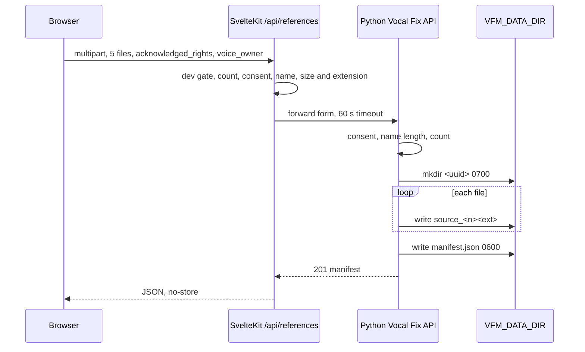

# Vocal Reference Storage

> Category: Architecture | Version: 1.1 | Date: November 2026 | Status: Active (legacy path)

For engineers working on Vocal Fix: how five reference recordings move from the browser through the SvelteKit proxy into the Python API, how they are laid out on disk, what the manifest records, and how deletion works. Pinned to commit 29c84e47. Intake only: no processing exists in this path.

> **Status at b58d4574.** This is the legacy path. The Vocal Fix UI now posts to `/api/sessions` and the pipeline runs in SvelteKit (ADR 0004, [`vocal-fix-pipeline.md`](vocal-fix-pipeline.md)), with decoded validation, sha256, a different on-disk layout (`<data>/vocal-fix/sessions/<id>/{originals,derived}`) and `VBM_DATA_DIR` rather than `VFM_DATA_DIR`. The proxy below still exists. Since this doc was written, it also requires an `x-vbm-intent` header (415 otherwise) before parsing the form (`apps/vocal-fix/src/routes/api/references/+server.ts:14-16`), and the app-wide localhost Host guard applies (`apps/vocal-fix/src/hooks.server.ts:5-10`). Proxy line numbers below are shifted by about three lines. The Python app is unchanged.

**Related:**
- [`vocal-fix-pipeline.md`](vocal-fix-pipeline.md)
- [`test-strategy.md`](test-strategy.md)
- [`../security/trust-boundaries.md`](../security/trust-boundaries.md)
- [`../auth/session-and-tenancy-model.md`](../auth/session-and-tenancy-model.md)
- [`../../../../docs/decisions/0001-independent-apps.md`](../../../../docs/decisions/0001-independent-apps.md)
- [`../../../../docs/decisions/0003-runtime-boundary.md`](../../../../docs/decisions/0003-runtime-boundary.md)

---

## Why it exists

Gold Vocal work will need an authorized set of source recordings kept untouched. Today the Python service only accepts and groups them; its own docstring says it performs no separation, synthesis or cloning (`apps/vocal_fix/app.py:1-5`), and the process endpoint always returns 501 (`apps/vocal_fix/app.py:156-162`).



## The SvelteKit proxy

`POST /api/references` returns 403 unless `NODE_ENV` is `development` (`apps/vocal-fix/src/routes/api/references/+server.ts:7-13`). It then requires a parseable multipart form (400 otherwise, `+server.ts:14-19`), exactly five `files` entries that are all files (`+server.ts:20-23`), `acknowledged_rights` equal to the string `true` (403 otherwise, `+server.ts:24-28`), a non-blank `voice_owner` (`+server.ts:29-30`), and each file 1 byte to 25 MiB with a `.wav`, `.mp3`, `.flac` or `.m4a` name (`+server.ts:3-4`, `+server.ts:31-37`). It forwards the form to `VOCAL_FIX_API_URL` (default `http://127.0.0.1:8001`) with a 60 second timeout (`+server.ts:38-46`) and passes the response body through as JSON with `no-store` (`apps/vocal-fix/src/lib/server/backend.ts:19-24`). `GET` and `DELETE` on `/api/references/[session_id]` apply the same dev gate and a lowercase UUID regex before proxying (`apps/vocal-fix/src/routes/api/references/[session_id]/+server.ts:3-45`).

## Python endpoints

| Method and path | Behavior |
|---|---|
| `GET /api/capabilities` | Reports 5 references, formats, 25 MiB limit, ingestion available, processing not implemented, `public_deployment_safe: False` (`apps/vocal_fix/app.py:61-72`) |
| `POST /api/references` | Create a session, 201 (`apps/vocal_fix/app.py:75-141`) |
| `GET /api/references/{session_id}` | Return the manifest (`apps/vocal_fix/app.py:144-146`) |
| `DELETE /api/references/{session_id}` | Remove the session folder (`apps/vocal_fix/app.py:149-153`) |
| `POST /api/references/{session_id}/process` | Always 501 after confirming the session exists (`apps/vocal_fix/app.py:156-162`) |

The Python layer repeats the checks independently: 403 without rights acknowledgement (`app.py:81-84`), 422 unless the trimmed performer name is 1 to 120 characters (`app.py:85-87`), 422 unless exactly five files (`app.py:88-89`), then per file 415 for an unsupported extension, 422 for empty and 413 over 25 MiB, reading at most one byte past the limit (`app.py:96-108`).

## Session ids

A new session id is `str(uuid4())` (`apps/vocal_fix/app.py:91`). On lookup, `session_path` accepts only an id equal to its own canonical UUID string and returns 404 otherwise, which blocks traversal and alternate spellings (`apps/vocal_fix/app.py:34-41`).

## On-disk layout

```text
$VFM_DATA_DIR/                 mode 0700 (app.py:28-31)
  <session uuid>/              mode 0700 (app.py:92-93)
    source_1.<ext> ... source_5.<ext>   (app.py:109-111)
    manifest.json              mode 0600 (app.py:132-134)
```

Stored names are derived from the position and lowercased extension, never from the uploaded filename (`apps/vocal_fix/app.py:97`, `app.py:109-110`). Audio files are written with `write_bytes` and no explicit mode (`app.py:111`), so their permissions follow the process umask (unverified at runtime). If anything fails mid-upload the whole folder is removed (`app.py:136-138`).

## Manifest fields

The manifest (`apps/vocal_fix/app.py:122-131`) contains `session_id`, `voice_owner`, `acknowledged_rights: True`, a UTC ISO `created_at`, `status: "uploaded-awaiting-processing"`, `gold_vocal_ready: False`, a fixed `note`, and `recordings`. Each recording holds `index`, `original_name` (basename only), `stored_name`, `bytes` and `integrity_verified: False` (`app.py:112-120`). The TypeScript mirror is `VocalReferenceSession` and `UploadedRecording` (`packages/contracts/src/index.ts:54-70`).

`integrity_verified` is always false because nothing decodes or probes the audio; acceptance means extension and size only.

## Consent fields

Consent is a self-asserted checkbox plus a free-text performer name. `acknowledged_rights` is recorded as `True` only because the request is refused otherwise (`app.py:81-84`, `app.py:125`). There is no identity of the uploader, no signature, no timestamped consent record separate from `created_at`, and no link to the `ownerConsentId` placeholder in `packages/database/src/index.ts:14`.

## The VFM_DATA_DIR working-directory trap

`root_dir` resolves `VFM_DATA_DIR`, defaulting to the relative `data/vocal-fix`, against the process working directory (`apps/vocal_fix/app.py:28-29`). Starting the API from another directory without the variable silently creates a fresh empty store, and existing sessions answer 404. Compose sets an absolute path on a named volume (`compose.yaml:5-8`); `.env.example` uses the relative `./data/vocal-fix` (`.env.example:6`). `data/` is git-ignored (`.gitignore:12`).

## Delete behavior

`DELETE` first loads the manifest (404 if absent), then `shutil.rmtree` removes the whole session folder, sources included, and returns `{"deleted": true, "session_id": ...}` (`apps/vocal_fix/app.py:149-153`). There is no soft delete, audit record or ownership check; anyone who can reach the API with the id can delete. A folder without a manifest cannot be deleted through the API (`app.py:44-48`).
