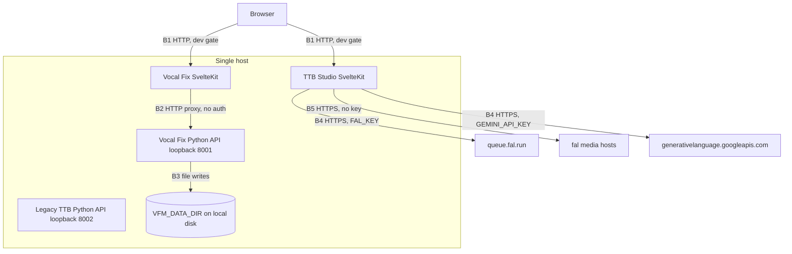

# Trust Boundaries

> Category: Security | Version: 1.0 | Date: November 2026 | Status: Active

For anyone deploying or extending the apps: every network and trust boundary in the current code, what crosses it, and which guards exist. Pinned to commit 29c84e47. No authentication exists anywhere on this ref.

**Related:**
- [`../auth/session-and-tenancy-model.md`](../auth/session-and-tenancy-model.md)
- [`../architecture/music-generation-pipeline.md`](../architecture/music-generation-pipeline.md)
- [`../architecture/vocal-reference-storage.md`](../architecture/vocal-reference-storage.md)
- [`../architecture/test-strategy.md`](../architecture/test-strategy.md)
- [`../../../../docs/decisions/0003-runtime-boundary.md`](../../../../docs/decisions/0003-runtime-boundary.md)

---

## Why this matters

The only thing standing between an anonymous browser and paid provider calls or stored voice recordings is a `NODE_ENV === 'development'` check. Nothing verifies who the caller is. Every boundary below should be read with that in mind.

The legacy TTB Python API has no inbound edge from SvelteKit: no TTB route imports `apps/ttb-studio/src/lib/server/backend.ts` (repository grep for `lib/server/backend` matched only Vocal Fix routes), although `compose.yaml:11-15` still starts it.

## B1: Browser to SvelteKit apps

Both production systemd units set `NODE_ENV=production` and bind `HOST=127.0.0.1` (`infra/systemd/vbm-vocal-fix.service:10-12`, `infra/systemd/vbm-ttb-studio.service:10-12`), so a reverse proxy would be required for public reach (unverified: no proxy config exists in the repository).

**TTB Studio guards.** `generationAllowed` returns true only when `NODE_ENV` is `development` (`apps/ttb-studio/src/lib/server/music/gate.ts:1-4`); otherwise `generationDisabledResponse` returns 403 (`gate.ts:6-12`). All three generation routes call it first (`apps/ttb-studio/src/routes/api/generations/+server.ts:23-24`, `[id]/+server.ts:10-11`, `[id]/audio/+server.ts:10-11`). `POST /api/generations` also refuses any content type other than `application/json` with 415 (`+server.ts:25-26`), so a cross-site form or `text/plain` POST cannot spend credit (`gate.ts:19-25`). `GET /api/capabilities` and `GET /api/health` are ungated but expose only booleans and status strings (`apps/ttb-studio/src/routes/api/capabilities/+server.ts:7-15`, `apps/ttb-studio/src/routes/api/health/+server.ts:3-10`).

**Vocal Fix guards.** Upload returns 403 outside development (`apps/vocal-fix/src/routes/api/references/+server.ts:7-13`), as do session read and delete (`apps/vocal-fix/src/routes/api/references/[session_id]/+server.ts:7-8`, `:27-28`). `GET /api/capabilities` is ungated and proxies to Python in every environment (`apps/vocal-fix/src/routes/api/capabilities/+server.ts:3-16`).

**What the gate is not.** Within development, any caller that can reach the dev server can submit, poll or download any job, and read or delete any session whose id it knows. Job and session ids are not bound to a caller (`[id]/+server.ts:12-19`, `[session_id]/+server.ts:9-10`). Dev servers bind to `127.0.0.1` (`apps/ttb-studio/package.json:7`, `apps/vocal-fix/package.json:7`).

## B2: SvelteKit to Python APIs

The Vocal Fix bridge reads its target from `VOCAL_FIX_API_URL`, defaulting to `http://127.0.0.1:8001`, and rejects non-HTTP protocols (`apps/vocal-fix/src/lib/server/backend.ts:2-8`). It forwards the multipart form unchanged with a 60 second timeout (`apps/vocal-fix/src/routes/api/references/+server.ts:38-46`) and rewraps the upstream body as JSON with `cache-control: no-store` (`backend.ts:19-24`). Transport failures become a generic 503 (`backend.ts:9-18`).

The Python APIs perform no authentication. Any process that can reach port 8001 can create, read and delete sessions directly (`apps/vocal_fix/app.py:75-153`). Compose publishes both ports on host loopback only (`compose.yaml:9-10`, `compose.yaml:14-15`), while the container processes listen on `0.0.0.0` (`compose.yaml:4`, `compose.yaml:13`). The Python capability payload itself declares `public_deployment_safe: False` (`apps/vocal_fix/app.py:71`).

## B3: Python to local filesystem

Vocal Fix writes under `VFM_DATA_DIR`, created with mode `0o700` (`apps/vocal_fix/app.py:28-31`). Session ids must be canonical UUIDs before any path is built (`apps/vocal_fix/app.py:34-41`), and stored filenames never use the uploaded name (`apps/vocal_fix/app.py:109-110`). Detail is in [`vocal-reference-storage.md`](../architecture/vocal-reference-storage.md).

## B4: SvelteKit to hosted providers

`FAL_KEY` and `GEMINI_API_KEY` are declared as server-only private variables (`apps/ttb-studio/src/env.ts:6-15`) and imported from `$app/env/private` (`apps/ttb-studio/src/routes/api/generations/+server.ts:1`). The fal key travels as an `authorization` header to `https://queue.fal.run` (`apps/ttb-studio/src/lib/server/music/fal.ts:5`, `fal.ts:55-61`). The Gemini key travels as `x-goog-api-key` to the Interactions endpoint (`lyria.ts:6`, `lyria.ts:79-85`; `lyricist.ts:6`, `lyricist.ts:98-104`). Lyricist requests set `store: false` (`lyricist.ts:108`). User prompt text crosses this boundary; the lyricist strips `<` and `>` and frames the text as data (`lyricist.ts:24-28`).

Provider error bodies are logged server-side only, truncated to 300 characters for fal and Lyria (`fal.ts:64`, `lyria.ts:91`) and reduced to status fields for the lyricist (`lyricist.ts:114-122`). Browsers receive only fixed public messages (`apps/ttb-studio/src/lib/server/music/errors.ts:11-15`).

## B5: SvelteKit to fal media hosts

The audio URL returned by fal is accepted only if it is HTTPS with no credentials or port and its host is `fal.media`, a subdomain of it, or `storage.googleapis.com` under `/falserverless/` (`fal.ts:132-143`). The download sends no key and refuses redirects (`apps/ttb-studio/src/routes/api/generations/[id]/audio/+server.ts:23-24`). The bytes are sniffed and size-capped before reaching the browser (`apps/ttb-studio/src/lib/server/music/audio.ts:98-148`).

## Data that crosses boundaries

| Data | Crosses | Stored |
|---|---|---|
| Five vocal recordings and performer name | B1, B2, B3 | Yes, on local disk |
| Song prompt and lyrics | B1, B4 | Not by this code; provider retention (unverified) |
| Generated audio | B5 or B4, then B1 | No; streamed or returned inline |
| Provider keys | B4 only | Server environment |
