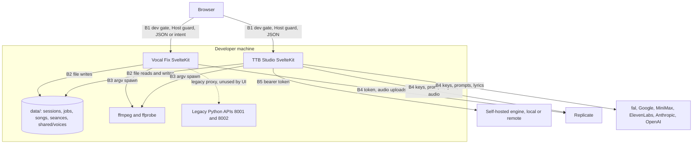

# Trust Boundaries

> Category: Security | Version: 2.0 | Date: November 2026 | Status: Active

For anyone deploying or extending the apps: every network and trust boundary in the current code, what crosses it, and which guards exist. Pinned to commit b58d4574 (version 1.0 was pinned to 29c84e47). No user authentication exists anywhere on this ref.

**Related:**
- [`../auth/session-and-tenancy-model.md`](../auth/session-and-tenancy-model.md)
- [`../architecture/song-studio.md`](../architecture/song-studio.md)
- [`../architecture/vocal-fix-pipeline.md`](../architecture/vocal-fix-pipeline.md)
- [`../architecture/audio-engine.md`](../architecture/audio-engine.md)
- [`../architecture/music-generation-pipeline.md`](../architecture/music-generation-pipeline.md)
- [`../../../../docs/decisions/0004-vocal-fix-pipeline-in-sveltekit.md`](../../../../docs/decisions/0004-vocal-fix-pipeline-in-sveltekit.md)

---

## Why this matters

Paid provider calls, stored recordings, forged voices and the song library are protected by three checks: `NODE_ENV === 'development'`, a localhost Host header, and a JSON content type or intent header on writes. None of them identifies a caller. Any local process or browser tab that can reach the dev server on a loopback name can act on any id it knows.

## B1: Browser to SvelteKit

**Vocal Fix.** `hooks.server.ts` refuses any `/api/` request whose Host is not `localhost`, `127.0.0.1` or `[::1]` (`apps/vocal-fix/src/hooks.server.ts:5-10`). Mutations also need development mode and either JSON or the `x-vbm-intent` header (`apps/vocal-fix/src/lib/server/gate.ts:35-46`). Reads need development mode only (`gate.ts:6-12`). Capabilities and health are ungated.

**TTB Studio.** Studio routes call `guard()`: development gate, Host guard, then JSON for writes (`apps/ttb-studio/src/lib/server/studio/context.ts:49-59`). The legacy `/api/generations` routes keep the development and JSON checks but have no Host guard (`apps/ttb-studio/src/routes/api/generations/+server.ts:23-26`). TTB has no `hooks.server.ts`. `GET /api/studio/capabilities` is ungated. It reveals which providers are configured, but not the keys (`apps/ttb-studio/src/routes/api/studio/capabilities/+server.ts:10-39`).

**Ids are the only keys.** Session, song, job, séance and voice ids are UUID-pattern checked, but they are not bound to a caller (`apps/vocal-fix/src/lib/server/storage.ts:80-85`, `apps/ttb-studio/src/lib/server/studio/library.ts:17-19`). Production systemd units set `NODE_ENV=production`, so every gated route answers 403 there.

## B2: Servers to local disk

Both apps write under `VBM_DATA_DIR` or `<repo root>/data` (`apps/vocal-fix/src/lib/server/paths.ts:15-18`, `apps/ttb-studio/src/lib/server/studio/paths.ts:4-19`). Paths are resolved and checked against the root (`storage.ts:80-95`). The shared voice registry is the one cross-app channel. Vocal Fix writes it, and TTB reads it, accepting only entries that pass `isVoiceModel` with `own_voice: true` and a safe model filename (`packages/contracts/src/voice.ts:28-57`, `apps/ttb-studio/src/lib/server/studio/voices.ts:5-36`). This file-level sharing crosses the "no implicit cross-product transfer of user voice data" target in `docs/ARCHITECTURE.md`; today only the self-attested consent fields gate it. File modes are not set explicitly (unverified at runtime).

## B3: ffmpeg subprocesses

Both apps spawn ffmpeg with argument arrays, never a shell (ADR 0004; `apps/ttb-studio/src/lib/server/studio/master.ts:95`). Vocal Fix bounds input at 100 MB and 600 s with a codec allow-list (`apps/vocal-fix/src/lib/server/media.ts:11-26`). The binaries come from `VBM_FFMPEG`/`VBM_FFPROBE` or `FFMPEG_PATH`, then PATH (`media.ts:6-10`, `master.ts:4-5`), so whoever controls the environment chooses the binary.

## B4: Servers to hosted providers

Keys are server-only environment variables (`apps/ttb-studio/src/env.ts:6-48`, `apps/vocal-fix/src/env.ts:6-11`). These leave the machine:

- Recordings and derived audio go to Replicate for Demucs, enhancement and RVC training.
- Songs go to Replicate for stems, reimagine and voice.
- A 30 s Gold Vocal excerpt goes to Replicate for voice summon.
- Prompts and lyrics go to the selected music and lyric providers.

Provider retention is unknown. Returned audio is sniffed and size-bounded before storage (`apps/ttb-studio/src/lib/server/studio/jobs.ts:245-262`). Spend is limited only by the local job caps (3 or 4 running in TTB, 2 in Vocal Fix), not by any budget.

## B5: TTB Studio to the self-hosted engine

The studio sends `Authorization: Bearer VBM_ENGINE_TOKEN` to `VBM_ENGINE_URL`, which may be `http:` (`apps/ttb-studio/src/lib/server/studio/runners/engine.ts:36-50`). The engine refuses to start without a token and compares it in constant time. Its Host guard is active only on a loopback bind; the Dockerfile binds `0.0.0.0` (`services/audio-engine/vbm_engine/app.py:104-144`, `services/audio-engine/Dockerfile:55`). `/v1/health` is unauthenticated and reveals the device and model readiness.

## Legacy Python

The legacy `apps/vocal_fix` and `apps/ttb_studio` APIs are unchanged and still unauthenticated. The Vocal Fix `/api/references` proxy to them now also requires `x-vbm-intent` (`apps/vocal-fix/src/routes/api/references/+server.ts:14-16`). No UI calls it.

## Data that crosses boundaries

| Data | Crosses | Stored |
|---|---|---|
| Recordings, derived takes, Gold Vocal | B1, B2, B4 | Local disk; Replicate retention unknown |
| Performer name and consent attestations | B1, B2 | `manifest.json` and voice registry |
| Trained voice model | B4 in, B2 | `shared/voices/<id>.model.zip` |
| Prompts, lyrics | B1, B4, B5 | `meta.json`; provider retention unknown |
| Songs, stems, covers | B4 or B5 in, B2 | `data/studio/songs/` |
| Keys and engine token | B4, B5 | Server environment |
