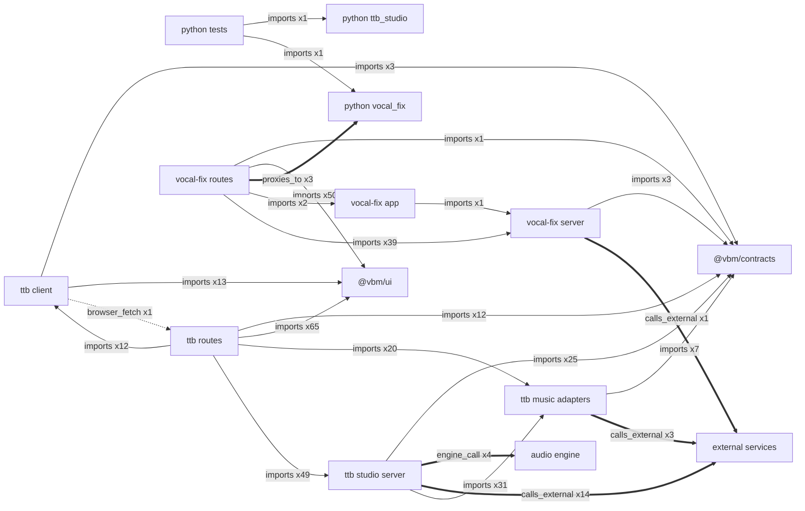

# Code graph

Deterministic graph of files, routes, endpoints and their edges at `b58d4574`, generated by `library/knowledge/private/wiki/tools/build_codegraph.py`. `codegraph.json` (node-link JSON) and `codegraph.mmd` (full file-level Mermaid) are generated artifacts; do not edit them by hand.

## Regenerate

```bash
python3.12 library/knowledge/private/wiki/tools/build_codegraph.py
```

Run from the repo root. At `b58d4574` it prints `{"nodes": 314, "links": 833, "sha256": "0e1678ca5eaa899f57577d272c2dc0a2ed3834ae24684640e58552a9d82fc958"}`; the sha256 is of the `codegraph.json` text. Two runs into separate directories produced byte-identical output.

## Coverage

Scanned: `apps/*/src/**/*.{ts,svelte}`, `packages/**/*.{ts,svelte,css}`, `apps/*/*.py`, `apps/*/index.html`, `tests/*.py` and, new this run, `services/**/*.py` (the audio engine). Python imports are resolved from the repo root, the service root (`services/audio-engine`) and relative imports, across the whole syntax tree so that lazy imports inside backend functions count.

## Node types

- `external-package` (17)
- `external-service` (13)
- `file` (208)
- `python-endpoint` (16)
- `sveltekit-route` (59)
- `unresolved-api-path` (1)

File kinds: module 130, static-page 2, stylesheet 1, svelte-component 49, test 26.

## Relations

- `browser_fetch` (39)
- `calls_external` (18)
- `defined_in` (75)
- `engine_call` (4)
- `imports` (691)
- `proxies_to` (3)
- `static_page_fetch` (3)

- `browser_fetch` covers `fetch(...)` and the app `api(...)` / `api<T>(...)` helpers when the first argument starts with a literal `/api/`; string concatenations and template literals are joined with each dynamic part as `*`.
- `engine_call` is the TTB engine runner's `at(deps, ...)` URL builder to an engine path (`apps/ttb-studio/src/lib/server/studio/runners/engine.ts`).

Known blind spots: URLs held in variables (audio and cover URLs built by `apps/ttb-studio/src/lib/client/api.ts`) produce no edge. The one `unresolved-api-path` is `POST /api/studio/songs/*/*` from `apps/ttb-studio/src/routes/library/[id]/+page.svelte`, whose last segment is chosen at runtime (stems, reimagine, voice, master or edit). Engine audio downloads use the URL the engine returns, so `GET /v1/jobs/{{job_id}}/audio` has no static caller.

## SvelteKit routes ({len(routes)})

- [[entities/route-ttb-delete-studio-jobs-id]]: apps/ttb-studio DELETE /api/studio/jobs/[id]
- [[entities/route-ttb-delete-studio-songs-id]]: apps/ttb-studio DELETE /api/studio/songs/[id]
- [[entities/route-ttb-get-capabilities]]: apps/ttb-studio GET /api/capabilities
- [[entities/route-ttb-get-generation]]: apps/ttb-studio GET /api/generations/[id]
- [[entities/route-ttb-get-generation-audio]]: apps/ttb-studio GET /api/generations/[id]/audio
- [[entities/route-ttb-get-health]]: apps/ttb-studio GET /api/health
- [[entities/route-ttb-get-studio-capabilities]]: apps/ttb-studio GET /api/studio/capabilities
- [[entities/route-ttb-get-studio-jobs-id]]: apps/ttb-studio GET /api/studio/jobs/[id]
- [[entities/route-ttb-get-studio-seances]]: apps/ttb-studio GET /api/studio/seances
- [[entities/route-ttb-get-studio-seances-id]]: apps/ttb-studio GET /api/studio/seances/[id]
- [[entities/route-ttb-get-studio-seances-leaderboard]]: apps/ttb-studio GET /api/studio/seances/leaderboard
- [[entities/route-ttb-get-studio-songs]]: apps/ttb-studio GET /api/studio/songs
- [[entities/route-ttb-get-studio-songs-id]]: apps/ttb-studio GET /api/studio/songs/[id]
- [[entities/route-ttb-get-studio-songs-id-audio]]: apps/ttb-studio GET /api/studio/songs/[id]/audio
- [[entities/route-ttb-get-studio-songs-id-cover]]: apps/ttb-studio GET /api/studio/songs/[id]/cover
- [[entities/route-ttb-get-studio-songs-id-edit]]: apps/ttb-studio GET /api/studio/songs/[id]/edit
- [[entities/route-ttb-get-studio-voices]]: apps/ttb-studio GET /api/studio/voices
- [[entities/route-ttb-page]]: apps/ttb-studio PAGE /
- [[entities/route-ttb-page-arcana]]: apps/ttb-studio PAGE /arcana
- [[entities/route-ttb-page-grimoire]]: apps/ttb-studio PAGE /grimoire
- [[entities/route-ttb-page-library]]: apps/ttb-studio PAGE /library
- [[entities/route-ttb-page-library-id]]: apps/ttb-studio PAGE /library/[id]
- [[entities/route-ttb-page-lyrics]]: apps/ttb-studio PAGE /lyrics
- [[entities/route-ttb-page-seance]]: apps/ttb-studio PAGE /seance
- [[entities/route-ttb-patch-studio-songs-id]]: apps/ttb-studio PATCH /api/studio/songs/[id]
- [[entities/route-ttb-post-generations]]: apps/ttb-studio POST /api/generations
- [[entities/route-ttb-post-studio-lyrics]]: apps/ttb-studio POST /api/studio/lyrics
- [[entities/route-ttb-post-studio-seances]]: apps/ttb-studio POST /api/studio/seances
- [[entities/route-ttb-post-studio-seances-id-rank]]: apps/ttb-studio POST /api/studio/seances/[id]/rank
- [[entities/route-ttb-post-studio-songs]]: apps/ttb-studio POST /api/studio/songs
- [[entities/route-ttb-post-studio-songs-id-cover]]: apps/ttb-studio POST /api/studio/songs/[id]/cover
- [[entities/route-ttb-post-studio-songs-id-edit]]: apps/ttb-studio POST /api/studio/songs/[id]/edit
- [[entities/route-ttb-post-studio-songs-id-master]]: apps/ttb-studio POST /api/studio/songs/[id]/master
- [[entities/route-ttb-post-studio-songs-id-reimagine]]: apps/ttb-studio POST /api/studio/songs/[id]/reimagine
- [[entities/route-ttb-post-studio-songs-id-stems]]: apps/ttb-studio POST /api/studio/songs/[id]/stems
- [[entities/route-ttb-post-studio-songs-id-voice]]: apps/ttb-studio POST /api/studio/songs/[id]/voice
- [[entities/route-vf-delete-reference]]: apps/vocal-fix DELETE /api/references/[session_id]
- [[entities/route-vf-delete-sessions-id]]: apps/vocal-fix DELETE /api/sessions/[id]
- [[entities/route-vf-delete-sessions-id-jobs-job]]: apps/vocal-fix DELETE /api/sessions/[id]/jobs/[job]
- [[entities/route-vf-delete-voices-voice-id]]: apps/vocal-fix DELETE /api/voices/[voice_id]
- [[entities/route-vf-get-capabilities]]: apps/vocal-fix GET /api/capabilities
- [[entities/route-vf-get-health]]: apps/vocal-fix GET /api/health
- [[entities/route-vf-get-reference]]: apps/vocal-fix GET /api/references/[session_id]
- [[entities/route-vf-get-sessions-id]]: apps/vocal-fix GET /api/sessions/[id]
- [[entities/route-vf-get-sessions-id-audio-area-file]]: apps/vocal-fix GET /api/sessions/[id]/audio/[area]/[file]
- [[entities/route-vf-get-sessions-id-jobs-job]]: apps/vocal-fix GET /api/sessions/[id]/jobs/[job]
- [[entities/route-vf-get-voices]]: apps/vocal-fix GET /api/voices
- [[entities/route-vf-page]]: apps/vocal-fix PAGE /
- [[entities/route-vf-page-arcana]]: apps/vocal-fix PAGE /arcana
- [[entities/route-vf-page-session-id]]: apps/vocal-fix PAGE /session/[id]
- [[entities/route-vf-page-session-id-forge]]: apps/vocal-fix PAGE /session/[id]/forge
- [[entities/route-vf-page-session-id-gold]]: apps/vocal-fix PAGE /session/[id]/gold
- [[entities/route-vf-page-voices]]: apps/vocal-fix PAGE /voices
- [[entities/route-vf-post-references]]: apps/vocal-fix POST /api/references
- [[entities/route-vf-post-sessions]]: apps/vocal-fix POST /api/sessions
- [[entities/route-vf-post-sessions-id-diagnose]]: apps/vocal-fix POST /api/sessions/[id]/diagnose
- [[entities/route-vf-post-sessions-id-forge]]: apps/vocal-fix POST /api/sessions/[id]/forge
- [[entities/route-vf-post-sessions-id-gold]]: apps/vocal-fix POST /api/sessions/[id]/gold
- [[entities/route-vf-post-sessions-id-repair]]: apps/vocal-fix POST /api/sessions/[id]/repair

## Python endpoints (16)

- [[entities/ep-ttb-get-root]]: apps/ttb_studio GET /
- [[entities/ep-ttb-get-capabilities]]: apps/ttb_studio GET /api/capabilities
- [[entities/ep-ttb-get-health]]: apps/ttb_studio GET /api/health
- [[entities/ep-ttb-post-generations]]: apps/ttb_studio POST /api/generations
- [[entities/ep-vf-delete-reference]]: apps/vocal_fix DELETE /api/references/{session_id}
- [[entities/ep-vf-get-root]]: apps/vocal_fix GET /
- [[entities/ep-vf-get-capabilities]]: apps/vocal_fix GET /api/capabilities
- [[entities/ep-vf-get-health]]: apps/vocal_fix GET /api/health
- [[entities/ep-vf-get-reference]]: apps/vocal_fix GET /api/references/{session_id}
- [[entities/ep-vf-post-references]]: apps/vocal_fix POST /api/references
- [[entities/ep-vf-post-process]]: apps/vocal_fix POST /api/references/{session_id}/process
- [[entities/ep-engine-delete-v1-jobs-job-id]]: services/audio-engine DELETE /v1/jobs/{job_id}
- [[entities/ep-engine-get-v1-health]]: services/audio-engine GET /v1/health
- [[entities/ep-engine-get-v1-jobs-job-id]]: services/audio-engine GET /v1/jobs/{job_id}
- [[entities/ep-engine-get-v1-jobs-job-id-audio]]: services/audio-engine GET /v1/jobs/{job_id}/audio
- [[entities/ep-engine-post-v1-jobs]]: services/audio-engine POST /v1/jobs

## Area view

Edges between source areas, counted from the graph. Edges inside one area (for example a page fetching an API route in the same app) are not shown here; file-level detail is in `codegraph.mmd`.


