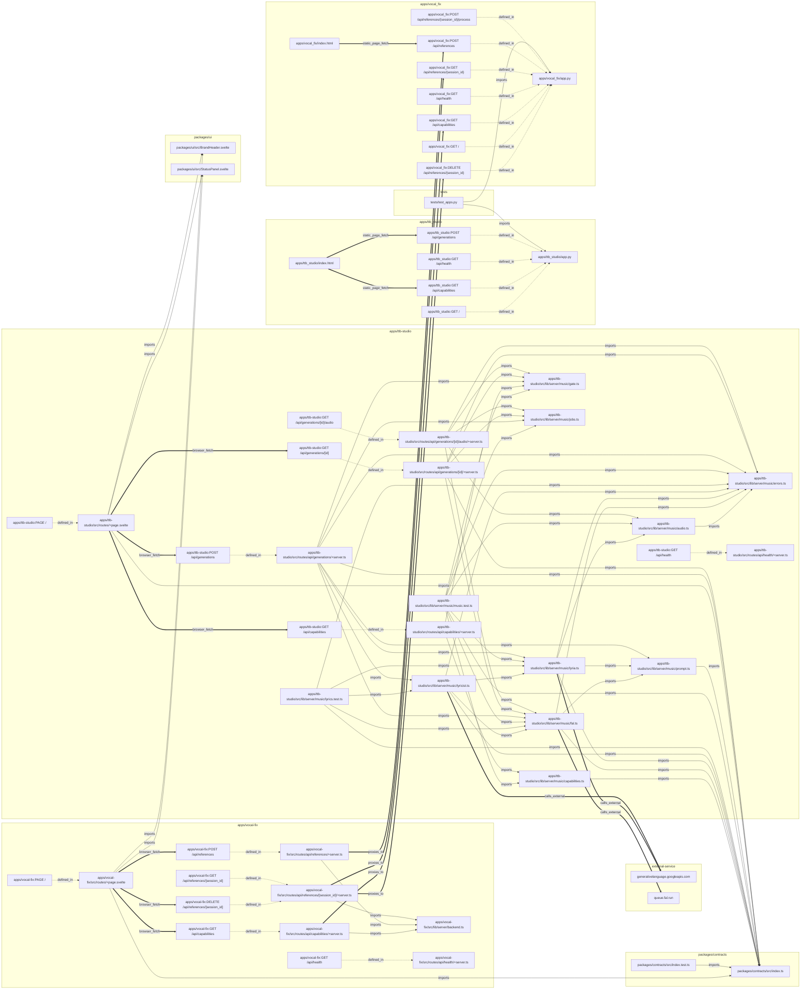

# Code graph

Deterministic graph of files, routes, endpoints and their edges, generated by `library/knowledge/private/wiki/tools/build_codegraph.py`. `codegraph.json` (node-link JSON) and `codegraph.mmd` are read-only inputs to this wiki.

## Regenerate

```bash
python3.12 library/knowledge/private/wiki/tools/build_codegraph.py
```

Run from the repo root; it rewrites both files and prints `{"nodes": 77, "links": 117, "sha256": "0e2cb3cc285881a1ecd62b823f32bca9bd642fdc4bf51a3618f2d8042da5ecdd"}` at `29c84e47`. The sha256 is of the `codegraph.json` text. (Verified this run by writing to a temporary directory and diffing: identical.)

## Node types

- `file` (44): a tracked source file; `kind` is module, svelte-component, static-page or test.
- `sveltekit-route` (12): one per exported HTTP method in a `+server.ts`, plus `PAGE` per `+page.svelte`.
- `python-endpoint` (11): one per FastAPI `@app.<method>` decorator.
- `external-package` (8): a bare npm/Bun import specifier; omitted from the Mermaid view.
- `external-service` (2): an `https://` host literal in non-test TS.

## Relations

- `imports` (78): static import between files or to a package.
- `defined_in` (23): route or endpoint to its file.
- `browser_fetch` (6): a page `fetch('/api/...')` literal to a SvelteKit route.
- `proxies_to` (4): a SvelteKit route `upstreamUrl(...)` call to a Python endpoint.
- `static_page_fetch` (3): a Python-served `index.html` fetch to a Python endpoint.
- `calls_external` (3): a module to an external host.

Known blind spots: fetches built from variables (the TTB page loading `audio_url`, `apps/ttb-studio/src/routes/+page.svelte:112`) produce no edge.

## SvelteKit routes

- [[entities/route-ttb-get-capabilities]]: GET /api/capabilities
- [[entities/route-ttb-get-generation]]: GET /api/generations/[id]
- [[entities/route-ttb-get-generation-audio]]: GET /api/generations/[id]/audio
- [[entities/route-ttb-get-health]]: GET /api/health
- [[entities/route-ttb-page]]: PAGE /
- [[entities/route-ttb-post-generations]]: POST /api/generations
- [[entities/route-vf-delete-reference]]: DELETE /api/references/[session_id]
- [[entities/route-vf-get-capabilities]]: GET /api/capabilities
- [[entities/route-vf-get-health]]: GET /api/health
- [[entities/route-vf-get-reference]]: GET /api/references/[session_id]
- [[entities/route-vf-page]]: PAGE /
- [[entities/route-vf-post-references]]: POST /api/references

## Python endpoints

- [[entities/ep-ttb-get-capabilities]]: GET /api/capabilities
- [[entities/ep-ttb-get-health]]: GET /api/health
- [[entities/ep-ttb-get-root]]: GET /
- [[entities/ep-ttb-post-generations]]: POST /api/generations
- [[entities/ep-vf-delete-reference]]: DELETE /api/references/{session_id}
- [[entities/ep-vf-get-capabilities]]: GET /api/capabilities
- [[entities/ep-vf-get-health]]: GET /api/health
- [[entities/ep-vf-get-reference]]: GET /api/references/{session_id}
- [[entities/ep-vf-get-root]]: GET /
- [[entities/ep-vf-post-process]]: POST /api/references/{session_id}/process
- [[entities/ep-vf-post-references]]: POST /api/references

## Mermaid


